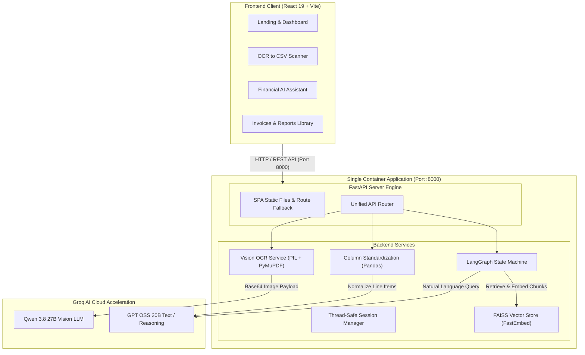
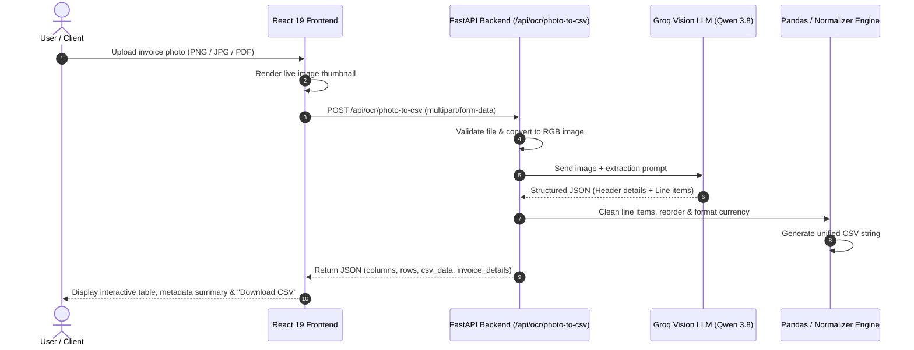
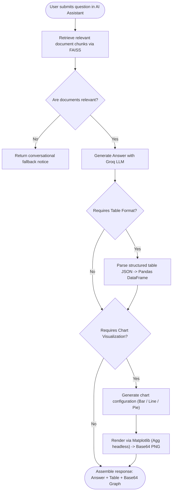
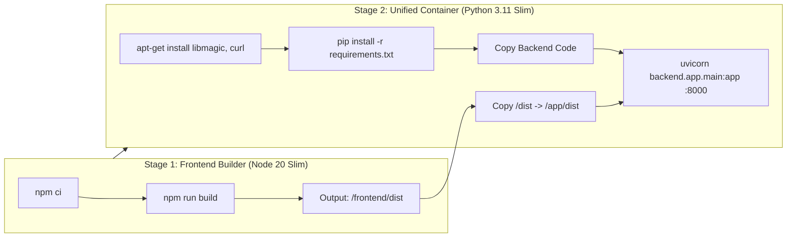

# Ledger AI

<p align="center">
  <strong>Intelligent Financial Operations, Vision OCR Extraction & Conversational Invoice Analytics</strong>
</p>

<p align="center">
  
  
  
  
  
  
  
  
</p>

---

## 📌 Overview

**Ledger AI** is an enterprise-grade financial operations platform that transforms raw invoice images, scans, and PDFs into verified, tabular data and conversational financial intelligence. Powered by **React 19**, **FastAPI**, **Groq Vision LLMs**, and **LangGraph RAG**, Ledger AI replaces manual bookkeeping with instant OCR table extraction, normalized CSV downloads, and natural-language Q&A with real-time chart visualizations.

Both the React single-page frontend and the FastAPI AI backend run seamlessly together inside a **single unified Docker container**.

---

## 🏗️ System Architecture



---

## 🔄 End-to-End Workflows

### 1. Photo to Tabular CSV Workflow
Upload any receipt or multi-page invoice photo to receive structured tabular records and download formatted CSV files instantly.



---

### 2. Conversational RAG & Chart Visualization Workflow
Ask questions in plain English across single or bulk invoices to receive answers, structured tables, and generated Matplotlib charts.



---

### 3. Single-Container Multi-Stage Build Pipeline



---

## 🚀 Key Features

- **📷 OCR Photo to Tabular CSV Scanner (`/api/ocr/photo-to-csv`):**
  - Instant conversion of scanned invoices, receipts, and multi-page PDFs to tabular data.
  - Automatic vendor identification, invoice number extraction, billing dates, line items, and totals.
  - Interactive on-screen table preview, toggleable raw CSV viewer, copy-to-clipboard, and CSV file download.
- **🤖 Financial AI Assistant & RAG Chatbot (`/api/v1/analyze`):**
  - Chat with your financial documents using natural language.
  - Automatic detection of structured requests (renders interactive data tables).
  - Automatic chart generation (renders clean Matplotlib bar charts, trend lines, and pie distributions in base64).
  - FastEmbed + FAISS vector indexing with thread-safe session management.
- **📑 Invoice Batch Processing & Master Ledger:**
  - Standardizes disparate column names across vendor formats.
  - Combines multiple invoices into unified master summaries.
- **🐳 Single Dockerfile Deployment:**
  - Unified multi-stage container serving both the React 19 SPA and FastAPI backend from port `8000`.
  - Zero CORS configuration required in production.

---

## 🛠️ Tech Stack

| Layer | Technology | Description |
|---|---|---|
| **Frontend** | React 19.2 | High-performance component-driven SPA |
| **Styling** | Tailwind CSS 3.4 | Utility-first responsive design system |
| **Bundler** | Vite 8.2 | Fast HMR dev server and production builder |
| **Backend API** | FastAPI 0.115 | Asynchronous REST backend framework |
| **Server** | Uvicorn | High-performance ASGI production server |
| **Vision LLM** | Groq `qwen/qwen3.8-27b` | High-speed multimodal OCR extraction |
| **Text / RAG LLM** | Groq `openai/gpt-oss-20b` | Financial reasoning, column harmonization, and RAG Q&A |
| **RAG Workflow** | LangGraph & LangChain | Stateful graph-based RAG workflow |
| **Vector Index** | FAISS + FastEmbed | In-memory similarity search and embedding model |
| **Document Tools**| PyMuPDF (`fitz`), Pillow, Pandas | PDF page rendering, image manipulation, and DataFrame pipelines |
| **Containerization**| Docker & Docker Compose | Multi-stage production container build |

---

## 📡 API Reference

### OCR & Invoice Processing

| Method | Endpoint | Description |
|---|---|---|
| `POST` | `/api/ocr/photo-to-csv` | Upload invoice photo and extract structured table + CSV (JSON or file download via `?format=csv`) |
| `POST` | `/api/ocr/process-invoices` | Process multi-file batch and stream back merged `processed_invoices.csv` |
| `POST` | `/api/ocr/extract-data` | Extract detailed JSON document metadata for RAG applications |
| `GET` | `/api/health` | System health check and Groq API dependency status |

### Conversational RAG Analytics

| Method | Endpoint | Description |
|---|---|---|
| `POST` | `/api/v1/upload/files` | Upload CSV or JSON invoices to create an indexed RAG vector session |
| `POST` | `/api/v1/upload/json` | Ingest structured JSON invoice payload directly into an active session |
| `POST` | `/api/v1/analyze` | Ask natural language questions; returns answers, data tables, and Matplotlib graphs |

---

## 💻 Getting Started

### Prerequisites

- **Docker** and **Docker Compose** (recommended), OR
- **Node.js** (v20+) and **Python** (v3.10+)

### 1. Run with Docker (Recommended)

1. **Clone the repository:**
   ```bash
   git clone https://github.com/Ledgerbro-Fintech-Solutions/Ledger-AI.git
   cd Ledger-AI
   ```

2. **Configure environment variables:**
   ```bash
   cp backend/.env.example backend/.env
   ```
   Add your Groq API key in `backend/.env`:
   ```env
   GROQ_API_KEY=your_actual_groq_api_key_here
   ```

3. **Build and start the unified container:**
   ```bash
   docker compose up --build
   ```

4. **Access the application:**
   - **Frontend & App:** [http://localhost:8000](http://localhost:8000)
   - **Interactive API Docs (Swagger):** [http://localhost:8000/docs](http://localhost:8000/docs)
   - **Health Check:** [http://localhost:8000/api/health](http://localhost:8000/api/health)

---

### 2. Local Development (Independent Dev Servers)

#### Backend Setup
```bash
# Navigate to backend and create virtual environment
cd backend
python3 -m venv venv
source venv/bin/activate

# Install dependencies
pip install -r requirements.txt

# Start FastAPI dev server
uvicorn app.main:app --host 0.0.0.0 --port 8000 --reload
```

#### Frontend Setup
```bash
# In the project root
npm install

# Start Vite development server (proxies API calls to port 8000)
npm run dev
```
Open [http://localhost:5173](http://localhost:5173) in your browser.

---

## 🧪 Automated End-to-End Testing

An automated verification test script is included to test all endpoints against live Groq models:

```bash
# Run inside the container or local environment
python backend/test_endpoints.py
```

**Verification Results:**
```text
==========================================================
Starting Ledger AI End-to-End Verification at http://localhost:8000
==========================================================
[1/6] Testing System Health Check...           ✓ PASSED
[2/6] Testing Single-Page Application (SPA)... ✓ PASSED
[3/6] Testing OCR Document Extraction...       ✓ PASSED
[4/6] Testing Invoices to Standardized CSV...  ✓ PASSED
[5/6] Testing RAG Chat Session Creation...     ✓ PASSED
[6/6] Testing RAG Natural Language Analysis... ✓ PASSED
[7/7] Testing Photo to Tabular CSV...          ✓ PASSED
==========================================================
ALL API ENDPOINTS TESTED AND VERIFIED SUCCESSFULLY!
==========================================================
```

---

## 📂 Project Structure

```
Ledger-AI/
├── Dockerfile                  # Unified multi-stage container build
├── docker-compose.yml          # Container configuration
├── package.json                # Frontend dependencies
├── vite.config.js              # Vite bundler & dev API proxy config
├── tailwind.config.js          # Design system tokens
├── public/                     # Static assets & sample invoices
│   └── sample-aws-invoice.png  # Pre-bundled AWS test invoice
├── src/                        # React 19 Frontend Application
│   ├── components/             # Reusable UI components (Navbar, Hero, Footer)
│   ├── pages/                  # Main views
│   │   ├── dashboard/          # Dashboard modules
│   │   │   ├── ChatbotTab.jsx  # Financial AI Assistant with LangGraph
│   │   │   ├── PhotoToCsvTab.jsx # OCR Photo to CSV Scanner
│   │   │   ├── InvoicesTab.jsx # Batch Invoices & Library
│   │   │   ├── ExportsTab.jsx  # CSV / XLSX / PDF Export Presets
│   │   │   └── ReportsTab.jsx  # Financial Analytics & Breakdown
│   │   ├── DashboardPage.jsx   # Main workspace shell & sidebar
│   │   └── LandingPage.jsx     # Marketing page
│   └── App.jsx                 # Client-side router
├── backend/                    # Unified Python FastAPI Backend
│   ├── app/
│   │   ├── core/               # Configuration, logging & RAG pipeline
│   │   │   ├── config.py       # Pydantic environment settings
│   │   │   ├── rag_pipeline.py # LangGraph RAG with Matplotlib chart generation
│   │   │   └── session_manager.py # Thread-safe FAISS session store
│   │   ├── models/             # Pydantic request & response schemas
│   │   ├── routes/             # API routes (OCR, Invoices, Chat, Health)
│   │   ├── services/           # Groq Vision OCR & harmonization services
│   │   ├── utils/              # PDF/image processing & DataFrame mergers
│   │   └── main.py             # FastAPI entry point & SPA static file router
│   ├── requirements.txt        # Backend dependencies
│   ├── test_endpoints.py       # End-to-end verification suite
│   └── .env.example            # Environment variables template
└── README.md                   # Project documentation
```

---

## 📄 License

This project is licensed under the [MIT License](LICENSE).
